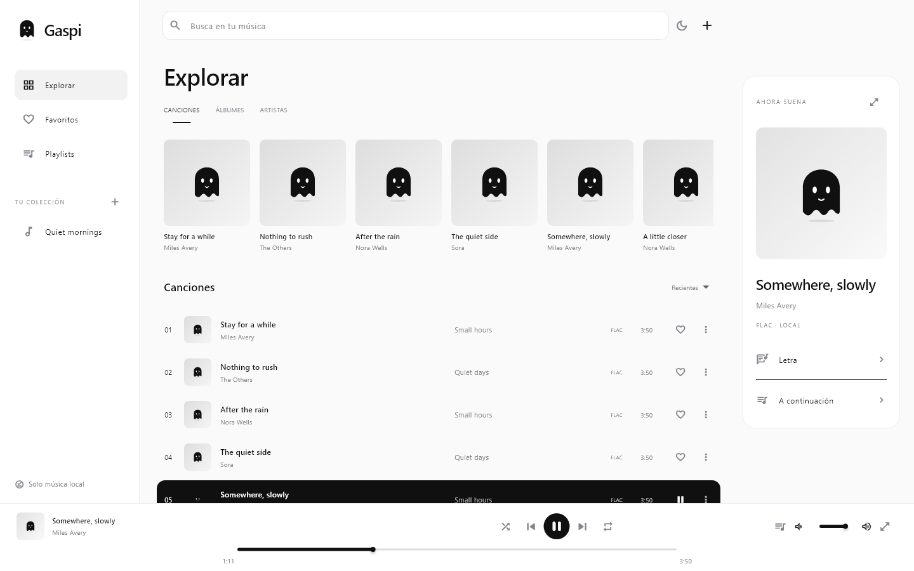
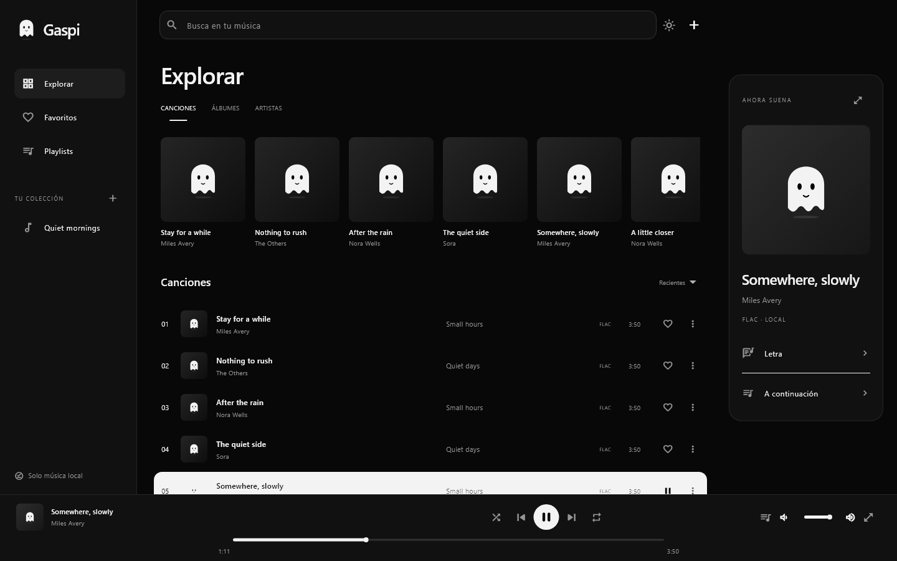
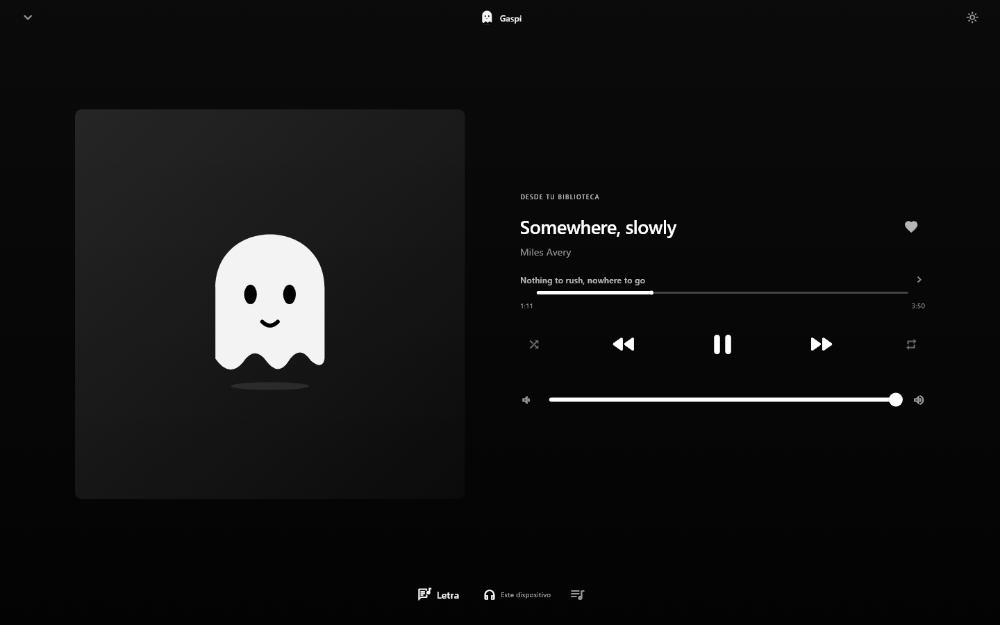
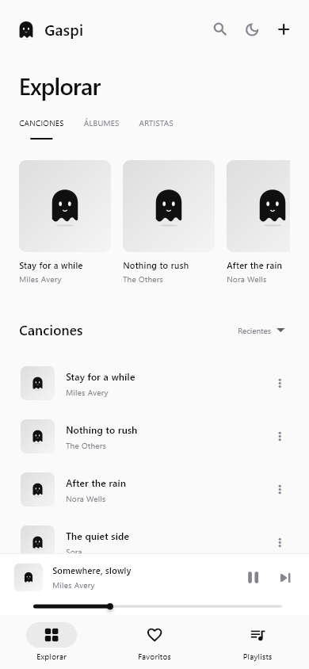
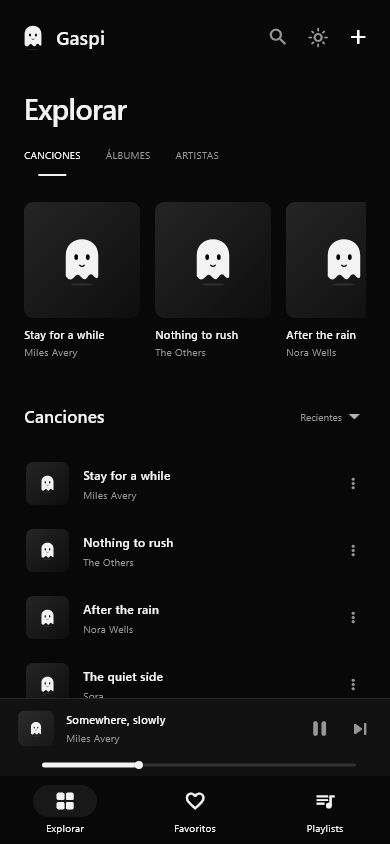
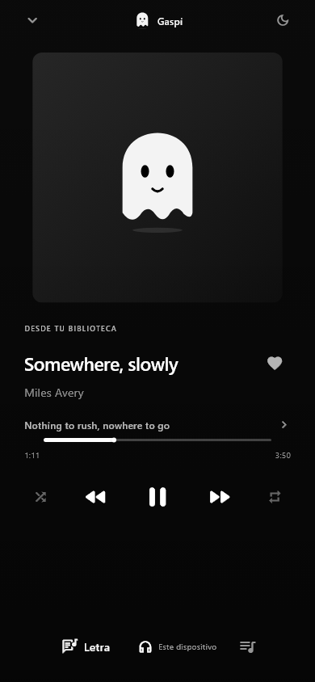

<div align="center">
  
  <h1>Gaspi</h1>
  <p><strong>Tu música. Tu espacio. Cero ruido.</strong></p>
  <p>Un reproductor de música local, minimalista y sin anuncios para Windows y Android.</p>
  <p>
    <a href="https://github.com/DAJEFF11/Gaspi/actions/workflows/release.yml"></a>
    
    
    
  </p>
</div>

## Escuchar, sin distracciones

Gaspi es un hogar para los archivos de música que ya tienes. Añade tus canciones, organiza tu colección y dale play. Sin registro, sin servicios de streaming y sin anuncios.

Una biblioteca limpia en blanco o negro mate profundo. Un pequeño fantasma que flota y parpadea. Un reproductor que deja espacio a lo que importa: la música.

## Descargas

**Gaspi 0.1.0 · primera versión de prueba.** Compilada con éxito para Windows y Android en GitHub Actions.

| Plataforma | Descarga directa |
| --- | --- |
| Windows x64 · instalador | [**Descargar Gaspi (.exe)**](https://github.com/DAJEFF11/Gaspi/releases/download/v0.1.0/Gaspi-Setup-windows-x64.exe) |
| Android · instalación manual | [**Descargar Gaspi (.apk)**](https://github.com/DAJEFF11/Gaspi/releases/download/v0.1.0/Gaspi-Android.apk) |
| Windows x64 · versión portátil | [Descargar ZIP portátil](https://github.com/DAJEFF11/Gaspi/releases/download/v0.1.0/Gaspi-Windows-portable.zip) |

[Notas de la versión](https://github.com/DAJEFF11/Gaspi/releases/tag/v0.1.0) · [SHA-256 de las descargas](https://github.com/DAJEFF11/Gaspi/releases/download/v0.1.0/SHA256SUMS.txt) · [Todas las versiones](https://github.com/DAJEFF11/Gaspi/releases)

El EXE instala Gaspi con sus DLL y datos. Para usar la versión portátil, extrae **todo** el ZIP y abre `gaspi.exe`. En Android, permite la instalación del APK desde el gestor de archivos que uses.

## Así se ve

### En tu PC





### Pantalla completa

Carátula grande, letra del momento y controles al alcance. Cuando hay una imagen embebida, el fondo la difumina suavemente; el modo oscuro reduce su intensidad.



### En tu móvil

<div align="center">
  
  &nbsp;&nbsp;
  
  &nbsp;&nbsp;
  
</div>

> Las capturas se renderizaron desde el código real de la interfaz con datos de demostración y un reproductor simulado. Las canciones ficticias no forman parte de la app. El fantasma aparece cuando el archivo no incluye carátula.

## Lo que puedes hacer

| Función | En Gaspi |
| --- | --- |
| Tu biblioteca | Importa canciones; en Windows también carpetas completas. |
| Tus formatos | MP3, FLAC, WAV, OGG, OPUS, M4A, AAC, AIF/AIFF, APE, WMA, ALAC y WV. |
| Tu organización | Búsqueda, álbumes, artistas, favoritos y playlists. |
| Tu reproducción | Pausa, anterior/siguiente, progreso, cola, aleatorio y repetición. |
| Tus letras | Letras embebidas, `.lrc` sincronizadas y `.txt`; pulsa una línea LRC para saltar a ese momento. |
| Tu estilo | Claro y negro mate profundo, con la elección guardada. |
| Tu dispositivo | Interfaz móvil y escritorio; vista inmersiva de reproducción. |

La decodificación depende del códec, contenedor y estado de cada archivo; no se promete compatibilidad con cualquier formato posible.

## Empieza en un momento

1. Abre Gaspi y pulsa **+** para añadir música.
2. Explora por **Canciones**, **Álbumes** o **Artistas**.
3. Marca favoritos o crea playlists desde el menú de una canción.
4. Pulsa el mini reproductor para ampliar la reproducción. En Windows puedes volver con **Esc**.
5. Carga una letra desde **Letra → Cargar** y usa el sol/luna para cambiar de tema.

## Tus archivos se quedan contigo

- **Windows:** Gaspi usa las ubicaciones originales. Si mueves tus archivos, vuelve a importarlos.
- **Android:** Gaspi guarda una copia privada de los archivos seleccionados para conservarlos después de cerrar el selector. Usa espacio adicional y se borra al desinstalar la app.
- Biblioteca, carátulas, favoritos, playlists, letras y tema se guardan localmente. No se suben a un servidor.
- Quitar una canción de la biblioteca quita su registro; esta versión conserva las copias y carátulas internas. No elimina tus originales.

## Identidad propia

El fantasmita de **Gaspi** está diseñado para la app y aparece en los iconos nativos de Windows y Android. Su animación respeta la preferencia de movimiento reducido del sistema.

[Logo SVG animado](branding/gaspi-logo.svg) · [Fantasmita GIF](branding/gaspi-ghost.gif) · [Icono PNG](branding/gaspi-icon.png)

## Desarrollo

Hecho con **Flutter**, **Dart** y el motor de audio nativo **media_kit/libmpv**.

```bash
git clone https://github.com/DAJEFF11/Gaspi.git
cd Gaspi
flutter pub get
flutter run -d windows
```

Para generar las entregas en Windows:

```powershell
.\Build-Gaspi.ps1 -Target all
```

Los binarios de GitHub se generan con el [workflow de compilación y Release](.github/workflows/release.yml). Windows incluye un instalador y una versión portátil; Android incluye un APK. Consulta la [guía técnica](docs/DEVELOPMENT.md) para requisitos y almacenamiento y el [registro de verificación](VERIFICACION.md) para conocer qué se ha probado.

## Estado de la primera versión

Esta es una **vista previa**. No incluye todavía servicio Android de reproducción en segundo plano, controles de pantalla bloqueada, ecualizador, sincronización entre dispositivos ni desplazamiento automático de letras.

Las compilaciones nativas de Windows y Android pasaron en GitHub Actions, junto al análisis de Dart y la suite de tres pruebas en ambas plataformas. También se verificaron nueve vistas/tamaños y seis comprobaciones directas de lógica. Las pruebas automatizadas no sustituyen probar audio, importación e instalación en dispositivos reales. El APK inicial usa firma de depuración para uso personal y el instalador Windows no tiene firma Authenticode.

REA se utilizó para inspeccionar estáticamente el instalador y el inventario de recursos de Spotify. Su análisis semántico quedó parcial por permisos. Gaspi utiliza código y logo propios y no incluye recursos de Spotify. [Informe de REA](analysis/REA-SPOTIFY.md).

---

<div align="center">Un pequeño fantasma. Toda tu música.<br /><strong>Un proyecto de <a href="https://github.com/DAJEFF11">DAJEFF11</a>.</strong></div>

